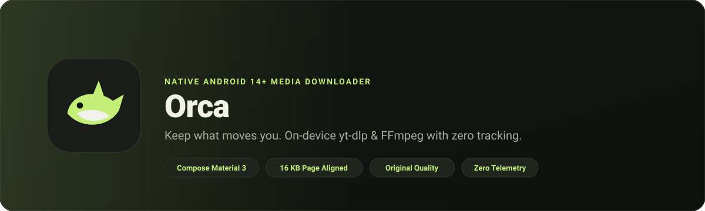
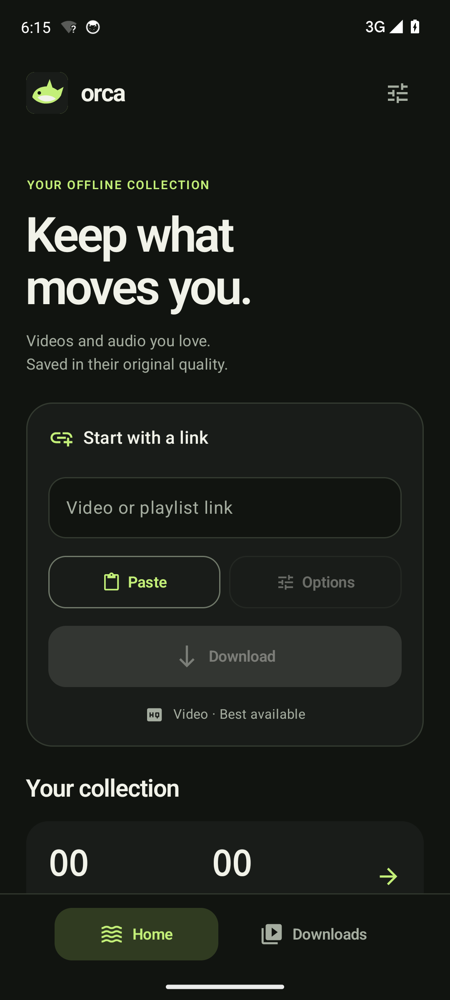
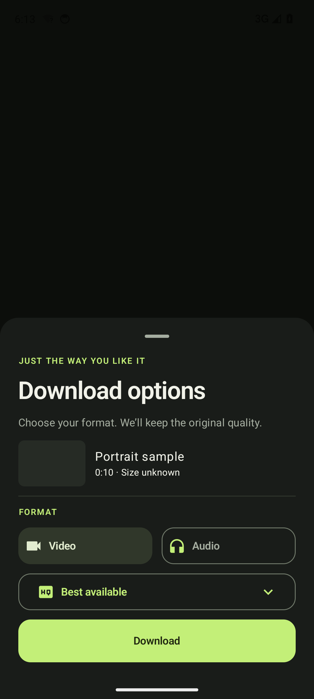
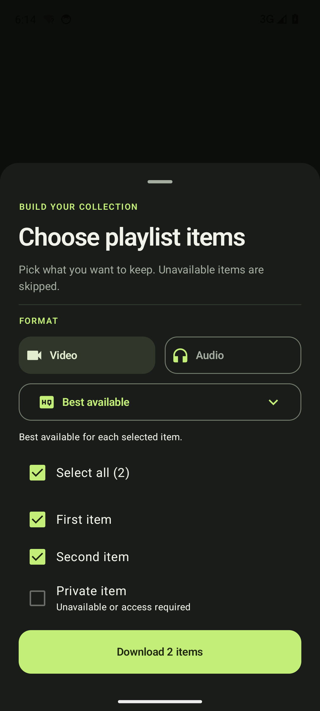
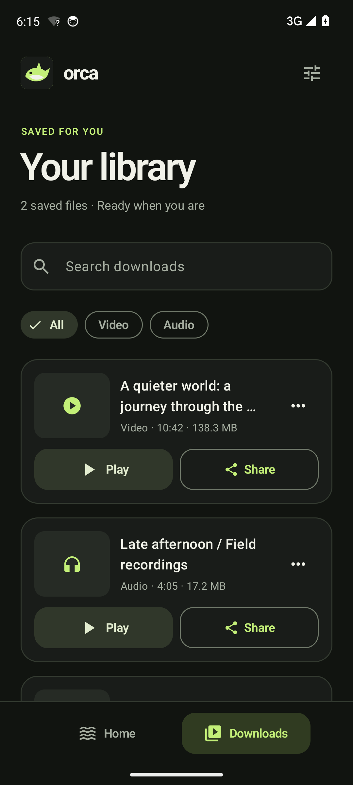
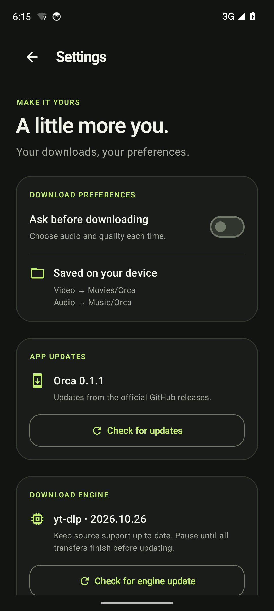
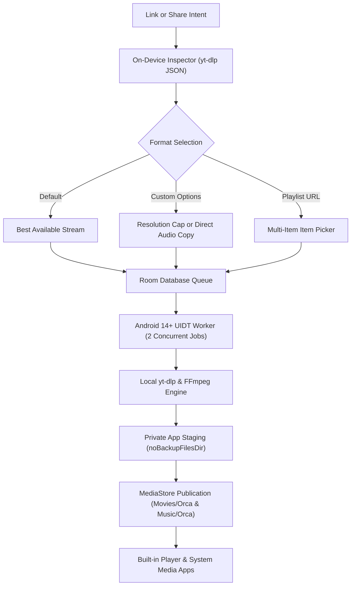

<p align="center">
  
</p>

<h1 align="center">Orca</h1>

<p align="center">
  <strong>Native Android 14+ video and audio downloader powered by on-device yt-dlp and FFmpeg.</strong>
</p>

<p align="center">
  <a href="https://github.com/projectGloria/Orca/releases/latest"></a>
  <a href="https://github.com/projectGloria/Orca/actions/workflows/ci.yml"></a>
  
  
  
</p>

<p align="center">
  
</p>

---

<p align="center">
  <a href="#about">About</a> &bull;
  <a href="#features">Features</a> &bull;
  <a href="#screenshots">Screenshots</a> &bull;
  <a href="#how-it-works">How it works</a> &bull;
  <a href="#installation">Installation</a> &bull;
  <a href="#usage">Usage</a> &bull;
  <a href="#building-from-source">Building from source</a> &bull;
  <a href="#configuration-and-updates">Configuration &amp; updates</a> &bull;
  <a href="#license-and-notices">License &amp; notices</a>
</p>

---

## About

Orca is a native, modern Android media downloader built with Jetpack Compose Material 3, Room, AndroidX Media3, and an on-device `yt-dlp` and FFmpeg execution engine. It extracts and downloads media entirely on your hardware with no middleman server, no user account, no tracking cookies, and zero analytics.

Downloads run via persistent Android 14+ User-Initiated Transfer services, keeping downloads reliable across app closures and network interruptions while saving original, uncompressed streams directly to your device's public media library.

## Features

- **On-device yt-dlp & FFmpeg engine:** Executes unmodified yt-dlp through Python and QuickJS locally on Android, giving you full extractor support without third-party proxies or cloud backends.
- **Uncompromised original quality:** Video requests fetch `bestvideo*+bestaudio/best` without forced re-encoding. Audio extraction uses FFmpeg direct stream copy (`-c:a copy`) rather than lossy conversion.
- **Android 14+ User-Initiated Transfers (UIDT):** Background downloads operate as prioritized user-initiated transfer jobs with real-time notifications, surviving process restarts and recovering interrupted partial streams.
- **Compose Material 3 design:** Styled in a high-contrast dark palette with responsive layouts, large-font support, and fluid bottom-sheet option selectors.
- **Playlist batch downloader:** Inspects multi-track URLs and playlists, letting you selectively pick tracks while automatically detecting and disabling private or unavailable entries.
- **MediaStore integration:** Media files are safely staged in private application storage and published into `Movies/Orca` and `Music/Orca` upon completion, remaining accessible after uninstallation.
- **Android 15 (16 KB page) compatibility:** Automatically patches bundled WebP native libraries during build to ensure complete 16 KB ELF segment alignment.
- **Dual updater system:** Independent, user-confirmed GitHub Releases checker for app updates, plus isolated on-device yt-dlp engine updates with atomic backup and rollback.

## Screenshots

<table align="center">
  <tr>
    <td align="center" width="33%">
      
      <br />
      <em><strong>Home:</strong> Paste or share links with quick format indicators.</em>
    </td>
    <td align="center" width="33%">
      
      <br />
      <em><strong>Options:</strong> Select video resolutions or pure audio stream extraction.</em>
    </td>
    <td align="center" width="33%">
      
      <br />
      <em><strong>Playlists:</strong> Selective batch download with unavailable-item detection.</em>
    </td>
  </tr>
  <tr>
    <td align="center" width="33%">
      
      <br />
      <em><strong>Library:</strong> In-app playback, file sharing, and source tracking.</em>
    </td>
    <td align="center" width="33%">
      
      <br />
      <em><strong>Settings:</strong> Download preferences, app updates, and engine updates.</em>
    </td>
    <td align="center" width="33%">
      <!-- Empty cell spacer for balanced layout -->
    </td>
  </tr>
</table>

## How it works

Orca coordinates stream extraction, queue persistence, native execution, and media publication entirely within Android:



1. **Inspection:** A shared or pasted URL is inspected using `yt-dlp --dump-single-json` to query available formats, streams, and playlist entries without downloading media.
2. **Transfer Queue:** Requests are stored in a local SQLite Room database. Two concurrent User-Initiated Transfer jobs drain the queue under foreground service notifications.
3. **Stream Assembly:** Video streams merge using FFmpeg if separate DASH feeds are retrieved. Audio extraction copies the original encoded stream directly into an optimal container.
4. **Publication:** Completed files stage in private app storage before being atomically inserted into Android's public `MediaStore` (`Movies/Orca` or `Music/Orca`). If a file with the same title already exists, a deterministic request suffix prevents accidental overwrites.

## Installation

### Prerequisites

- An Android device or emulator running **Android 14 (API level 34)** or higher.
- Architectures supported: `ARM64` (most modern phones) and `x86_64` (emulators and Chromebooks).

### Download prebuilt APKs

Official signed release builds are published under [GitHub Releases](https://github.com/projectGloria/Orca/releases):

1. Download `Orca-<version>-arm64.apk` for your physical phone (or `x86_64` for emulators).
2. Sideload the APK onto your device or run:
   ```bash
   adb install -r Orca-0.1.1-arm64.apk
   ```
3. Grant the required notification permission on initial launch so transfer progress can display.

## Usage

### 1. Download best available quality

1. Copy any supported media URL to your clipboard.
2. Open Orca and tap **Paste** (or share a link directly to Orca from any web browser or media app).
3. Tap **Download**. Orca automatically fetches the highest quality video and audio streams available.

### 2. Extract audio without quality loss

1. Paste or share the link.
2. Tap **Options** before downloading (or enable *Ask before downloading* in Settings).
3. Select **Audio** and tap **Download**. Orca copies the native audio stream directly using FFmpeg without transcoding.

### 3. Batch download playlists

1. Paste a playlist URL (e.g., `https://www.youtube.com/playlist?list=...`).
2. The playlist picker will open automatically, inspecting all entries and highlighting unavailable or private items.
3. Select the items you want to keep, choose your target format, and tap **Download selected items**.

## Building from source

### Prerequisites

- **JDK 17** (e.g. Eclipse Temurin 17 or OpenJDK 17). Ensure `JAVA_HOME` is set.
- **Android SDK Platform 35** with **Build-Tools 35.0.0**. Ensure `ANDROID_HOME` is set.
- **Gradle 8.11.1** (enforced by the checked-in wrapper with SHA-256 validation).

### Step-by-step build

1. **Clone the repository:**
   ```bash
   git clone https://github.com/projectGloria/Orca.git
   cd Orca
   ```

2. **Run test suite and assemble debug builds:**
   - On Windows (PowerShell):
     ```powershell
     .\gradlew.bat testDebugUnitTest lintDebug assembleDebug
     ```
   - On Linux / macOS:
     ```bash
     ./gradlew testDebugUnitTest lintDebug assembleDebug
     ```

3. **Locate built APKs:**
   Debug APKs are generated under:
   ```text
   app/build/outputs/apk/debug/app-arm64-v8a-debug.apk
   app/build/outputs/apk/debug/app-x86_64-debug.apk
   ```

### 16 KB page patching details

Orca automatically patches the five WebP dynamic libraries within the `youtubedl-android` FFmpeg runtime during build, replacing 4 KB ELF segments with ABI-compatible 16 KB aligned Termux binaries. See [vendor/webp/README.md](vendor/webp/README.md) for package checksums and native dependency provenance.

## Configuration and updates

<details>
<summary><strong>Personal signing configuration</strong></summary>

To build signed release APKs, create an RSA signing key using `keytool` and define its location in `signing.properties` (this file is excluded from Git):

```properties
storeFile=C:/Users/you/.android/orca/orca-personal.jks
storePassword=YOUR_KEYSTORE_PASSWORD
keyAlias=orca
keyPassword=YOUR_KEY_PASSWORD
```

Then assemble the release build:
```bash
./gradlew assembleRelease
```
</details>

<details>
<summary><strong>In-app update checks</strong></summary>

Navigate to **Home &rarr; Settings &rarr; App updates &rarr; Check for updates**:
- Orca queries the official [projectGloria/Orca Releases API](https://github.com/projectGloria/Orca/releases) directly.
- Compares Android version codes and presents the matching ABI APK link.
- Never downloads or installs updates silently; tapping **Download update** directs you to the official GitHub APK release download.

Engine updates for the embedded `yt-dlp` executable are handled separately under **Download engine &rarr; Check for engine update**. Orca maintains an atomic engine backup to automatically roll back if an update is interrupted or corrupt.
</details>

<details>
<summary><strong>Continuous Integration & GitHub Releases</strong></summary>

GitHub Actions runs automated build, lint, and unit test suites on all pushes and pull requests (`ci.yml`). Signed release deployment (`release.yml`) executes when incrementing `versionCode` and `versionName` in [version.properties](version.properties), publishing signed artifacts, SHA-256 checksums, and update manifests to GitHub Releases.
</details>

## Contributing

Contributions, bug reports, and feature requests are welcome!

1. Fork the repository and create a feature branch (`git checkout -b feature/my-feature`).
2. Verify all local tests pass before opening a PR:
   ```bash
   ./gradlew testDebugUnitTest lintDebug
   ```
3. Commit your changes and submit a pull request. PRs are tested automatically against the CI workflow.

## License and notices

Orca is developed as an open-source personal project. It incorporates and depends on the following upstream components:

| Component | License | Notice / Upstream Link |
| --- | --- | --- |
| **youtubedl-android** | MIT | [yausername/youtubedl-android](https://github.com/yausername/youtubedl-android/tree/0.18.1) |
| **yt-dlp** | The Unlicense | [yt-dlp/yt-dlp](https://github.com/yt-dlp/yt-dlp) |
| **FFmpeg 7.1.1** | GPL v3 | [ffmpeg.org](https://ffmpeg.org/) (bundled with x264/x265) |
| **Python** | PSF License | [python.org](https://docs.python.org/3/license.html) |
| **QuickJS** | MIT | [bellard/quickjs](https://github.com/bellard/quickjs) |
| **WebP / libsharpyuv** | BSD-3-Clause | [webmproject/libwebp](https://github.com/webmproject/libwebp) (16 KB aligned) |
| **AndroidX & Jetpack** | Apache 2.0 | [Android Open Source Project](https://android.googlesource.com/platform/frameworks/support/) |
| **Kotlin & Coroutines** | Apache 2.0 | [JetBrains/kotlin](https://github.com/JetBrains/kotlin) |
| **Coil** | Apache 2.0 | [coil-kt/coil](https://github.com/coil-kt/coil) |

For complete component details, patent grants, and third-party notices, refer to [THIRD_PARTY_NOTICES.md](THIRD_PARTY_NOTICES.md).

For test suites, emulator logs, and live source probe records, see [VALIDATION.md](VALIDATION.md).
